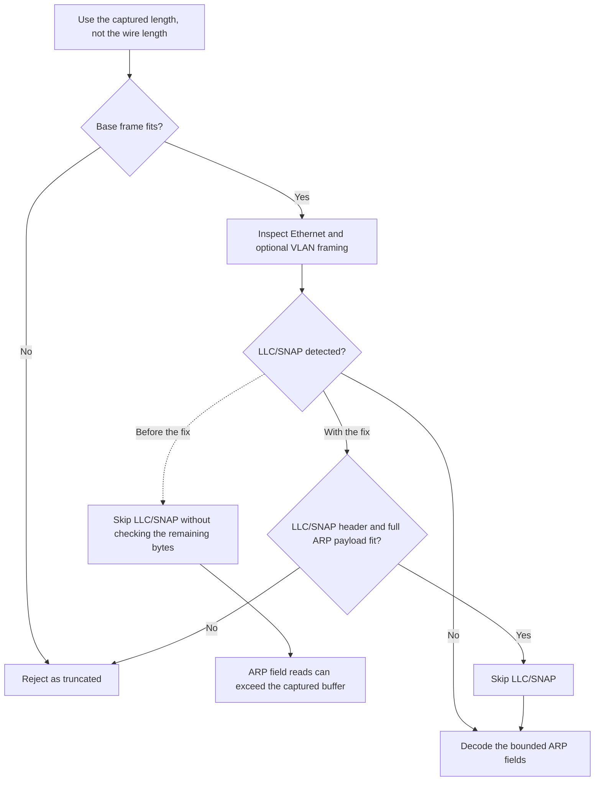

# LLC/SNAP ARP decoder bounds check

The initial receive check covers Ethernet and the fixed ARP fields. Optional encapsulation changes where the ARP fields begin, so the decoder must check the captured length again before reading them.

AddressSanitizer confirmed the out-of-bounds read in a direct parser test before the fix. Live-network behavior was not verified. This page documents the fix; adding it does not change the decoder.
